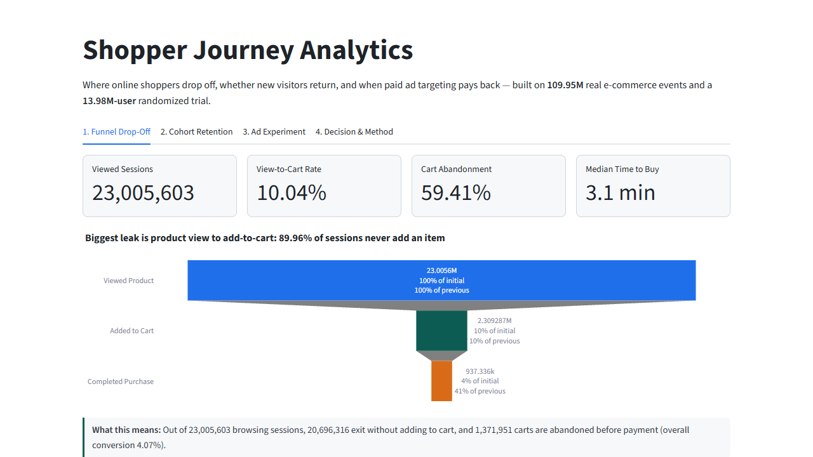

# Shopper Journey Analytics

This project measures where online shoppers drop off, whether new visitors return, and when an ad campaign is worth scaling. It analyzes 109,950,743 REES46 e-commerce events (23,005,603 viewed sessions) and the 13,979,592-user Criteo Uplift v2.1 randomized ad trial.

Headline findings:
1. 89.96% of viewed sessions drop off before adding to cart (`10.04%` view-to-cart; `59.41%` cart abandonment; `4.07%` view-to-purchase).
2. Among 4,359,106 eligible new shoppers, `27.51%` return within 7 days and `49.74%` within 28 days; `32.24%` of first-time buyers repeat within 28 days.
3. Ads lift conversions by `+1.152` per 1,000 users (`+59.45%` relative, `p = 7.31e-179`), rising to `+15.51` per 1,000 in the top segment (`f10 > 5.3`).

Live App: https://shopper-journey-analytics.onrender.com | Static Report: https://anushka13102003.github.io/shopper-journey-analytics/



The live app runs on a free host and may take about a minute to wake up on first visit. A static copy of the report is always available here: https://anushka13102003.github.io/shopper-journey-analytics/

## How to Run

```bash
python -m venv .venv
# Windows PowerShell: .\.venv\Scripts\Activate.ps1
# Mac/Linux: source .venv/bin/activate
pip install -r requirements.txt
python run_all.py
streamlit run app/streamlit_app.py
```

Running `python run_all.py` downloads both public datasets (requires Kaggle credentials in `KAGGLE_API_TOKEN`, `~/.kaggle/access_token`, or `~/.kaggle/kaggle.json`), profiles data quality, runs all DuckDB SQL queries and statistical tests, and writes aggregated outputs to `outputs/` and `docs/index.html`.

To run lint and tests on the included real 20k-row sample fixture without downloading raw data:

```bash
ruff check src/ tests/ app/ run_all.py
pytest -v
```

## Folder Map

- `sql/`: Numbered DuckDB SQL queries (`01_funnel.sql`, `02_cohorts.sql`, `03_retention_curve_and_repeat.sql`) using CTEs and window functions.
- `src/`: Python pipeline (`ingest.py`, `stats.py`, `build_outputs.py`).
- `app/`: Streamlit dashboard (`streamlit_app.py`) reading only small aggregated Parquet/JSON files from `outputs/`.
- `docs/`: [Executive Summary](docs/executive_summary.md), [Metric Definitions](docs/metric_definitions.md), [Experiment Design](docs/experiment_design.md), [Data Quality](docs/data_quality.md), [Decisions](docs/decisions.md), [Limitations](docs/limitations.md), and static report (`index.html`).
- `outputs/`: Aggregated Parquet and JSON files (`<100 KB` total).
- `tests/`: Unit tests for statistical functions, SQL invariant checks, and real 20k-row sample fixture (`tests/fixtures/rees46_sample.parquet`).

## Methods

- **Part A (REES46 Funnel & Cohorts)**: DuckDB streams `2019-Oct.csv` and `2019-Nov.csv` out-of-core (`4 GB` memory limit). Session funnel requires `has_view = 1` so stages stay monotonic (`23,005,603 >= 2,309,287 >= 937,336`; median `3.12` min from first view to purchase). Cohorts exclude users first seen in the first 7 days (`2019-10-01` to `2019-10-07`) as pre-existing traffic and restrict D7/D14/D28 denominators to users whose full return window lies inside the 61-day log.
- **Part B (Criteo Uplift Experiment)**: Evaluated on an Intention-to-Treat basis (`85.00%` treatment, `15.00%` control). Covariate balance passes across all 12 features (`max |SMD| = 0.0488 < 0.10`). Two-proportion z-tests, Wald 95% CIs, MDE at 80% power (`alpha = 0.05`), 25 Benjamini-Hochberg adjusted quantile segment cuts, and an explicit break-even cost table support targeted rollout to high-propensity segments (`f10 > 5.3` / `f4 > 10.28`).

## Limitations

- First-seen in a 61-day log is an approximation of a new user, not a true account-creation date.
- The 2-month window limits D28 return (`2,205,364` eligible users) and 28-day repeat purchase (`274,794` eligible buyers).
- REES46 Oct-Nov 2019 files contain zero `remove_from_cart` events and `32.21%` null `category_code`.
- Criteo features `f0..f11` are anonymized and no real ad cost or order margin is provided.
- Part A and Part B come from different companies and are combined to show the end-to-end analyst workflow.
