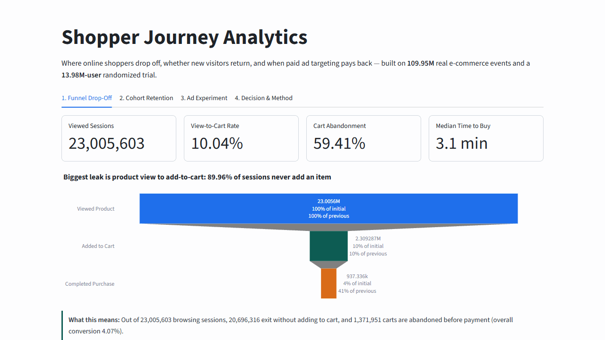

# Shopper Journey Analytics

Finds where online shoppers drop off, who comes back, and when paid ads pay back for growth teams.

[](https://shopper-journey-analytics.onrender.com)
[](https://anushka13102003.github.io/shopper-journey-analytics/)
[](https://github.com/ANUSHKA13102003/shopper-journey-analytics/actions/workflows/ci.yml)
[](requirements.txt)



## Key results

| Area | Result | What it means |
| :--- | :--- | :--- |
| **Biggest drop-off** | **89.96%** view-to-cart loss | Across `23,005,603` viewed sessions, only `10.04%` add to cart and `59.41%` of carts abandon (`4.07%` view-to-purchase; `3.12` min median time to buy). |
| **28-day return** | **49.74%** within 28 days | Half of `2,205,364` full-window new shoppers visit again within 28 days (`27.51%` within 7 days; `10.09%` exact Day 1 to `4.44%` Day 28). |
| **Repeat buying** | **32.24%** in 28 days | `88,596` of `274,794` first-time buyers place a second order within 28 days, showing healthy post-purchase retention. |
| **Ad experiment lift** | **+1.152** / 1,000 users | Across `13,979,592` users (`+59.45%` relative, `p = 7.31e-179`), top-quartile `F10 > 5.3` reaches **+15.51** per 1,000 (`13.5x` average). |
| **Decision** | **Target top segments** | Blanket ad spend breaks even only below `1.15` per user (at `1,000` order value), vs `15.51` per user in the top quartile. |

## The decision

Do not scale blanket ad spend across the full user base. Fix product-page add-to-cart friction (`89.96%` drop-off) and checkout abandonment (`59.41%`) first, then restrict paid campaigns to high-propensity segments (`F10 > 5.3` / `F4 > 10.28`) where incremental conversion lift is `13.5x` the population average and clears ad cost. Monitor treatment exposure rate (`3.60%`) and 28-day buyer repeat rate (`32.24%`) on acquired cohorts.

## What I built

- **Session funnel in DuckDB SQL** ([sql/01_funnel.sql](sql/01_funnel.sql)): Streams `109,950,743` events out-of-core (`<4 GB` RAM) to measure `view -> cart -> purchase` conversion, abandonment, and time-to-purchase across categories, price bands, weekdays, and hours.
- **Censored-window retention cohorts** ([sql/02_cohorts.sql](sql/02_cohorts.sql), [sql/03_retention_curve_and_repeat.sql](sql/03_retention_curve_and_repeat.sql)): Applies a 7-day washout for existing traffic (`4,359,106` eligible new shoppers) and enforces full-window denominators for cumulative `D7/D14/D28`, exact-day `D1..D28`, and 28-day repeat purchases.
- **Randomized ad uplift evaluation** ([src/stats.py](src/stats.py), [app/streamlit_app.py](app/streamlit_app.py)): Runs covariate balance checks (`max |SMD| = 0.0488`), 80%-power MDE, two-proportion z-tests, 25 Benjamini-Hochberg adjusted quantile cuts, and a break-even sensitivity table served in a 4-tab Streamlit app and [static HTML report](https://anushka13102003.github.io/shopper-journey-analytics/).

## Data used

- **Part A (Storefront clickstream)**: [REES46 Multi-Category Store](https://www.kaggle.com/datasets/mkechinov/ecommerce-behavior-data-from-multi-category-store) (`2019-Oct.csv` + `2019-Nov.csv`; `109,950,743` events, `5,316,649` users, 14.68 GB raw CSVs).
- **Part B (Ad experiment)**: [Criteo Uplift Prediction Dataset v2.1](https://huggingface.co/datasets/criteo/criteo-uplift) (`13,979,592` randomized users; 85% treatment / 15% control; features `f0..f11`, `treatment`, `exposure`, `visit`, `conversion`).

## How to run

**Windows (PowerShell):**
```powershell
git clone https://github.com/ANUSHKA13102003/shopper-journey-analytics.git; cd shopper-journey-analytics
python -m venv .venv; .\.venv\Scripts\pip install -r requirements.txt
.\.venv\Scripts\python -m pytest -v
.\.venv\Scripts\streamlit run app/streamlit_app.py
```

**Mac / Linux:**
```bash
git clone https://github.com/ANUSHKA13102003/shopper-journey-analytics.git && cd shopper-journey-analytics
python3 -m venv .venv && .venv/bin/pip install -r requirements.txt
.venv/bin/python -m pytest -v
.venv/bin/streamlit run app/streamlit_app.py
```

The repo includes pre-aggregated outputs (`outputs/`, `<100 KB`) and a real 20k-row sample fixture (`tests/fixtures/rees46_sample.parquet`) so the app and tests run immediately. To rebuild everything from raw downloads (requires Kaggle credentials in `~/.kaggle/kaggle.json` or `KAGGLE_API_TOKEN`), run `python run_all.py`.

## Project structure

```text
shopper-journey-analytics/
├── app/streamlit_app.py              # 4-tab Streamlit dashboard (reads outputs/ only)
├── sql/                              # 01_funnel.sql, 02_cohorts.sql, 03_retention_curve_and_repeat.sql
├── src/                              # ingest.py, stats.py, build_outputs.py
├── outputs/                          # Pre-aggregated Parquet & JSON (<100 KB)
├── docs/                             # Executive summary, definitions, design, quality, index.html, img/
├── tests/                            # pytest suite + 20k real sample fixture
└── run_all.py                        # End-to-end rebuild from raw CSVs
```

## Methods and metric definitions

Full formulas and engineering notes are in [docs/executive_summary.md](docs/executive_summary.md), [docs/metric_definitions.md](docs/metric_definitions.md), [docs/experiment_design.md](docs/experiment_design.md), [docs/data_quality.md](docs/data_quality.md), and [docs/decisions.md](docs/decisions.md).

## Limitations

- **First-seen is not a brand-new account**: Excluding the first 7 days removes frequent existing regulars, but infrequent shoppers returning after October 7 still enter cohorts.
- **61-day window censors late cohorts**: Full 28-day windows exist only for shoppers arriving on or before November 2 (`2,205,364` users and `274,794` first-time buyers).
- **Schema gaps & anonymized covariates**: REES46 Oct-Nov 2019 has zero `remove_from_cart` events and `32.21%` null categories; Criteo features `f0..f11` are anonymized and exclude ad spend, and Part A / Part B come from separate companies. See [docs/limitations.md](docs/limitations.md).
